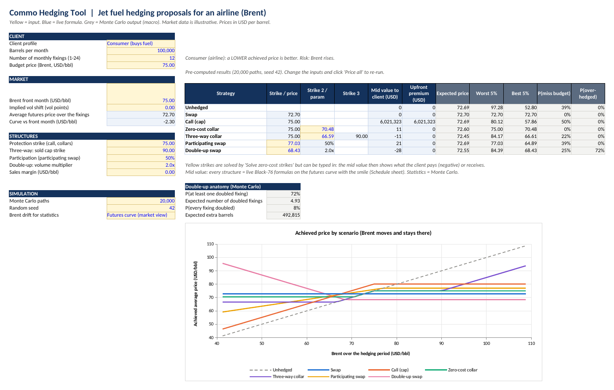
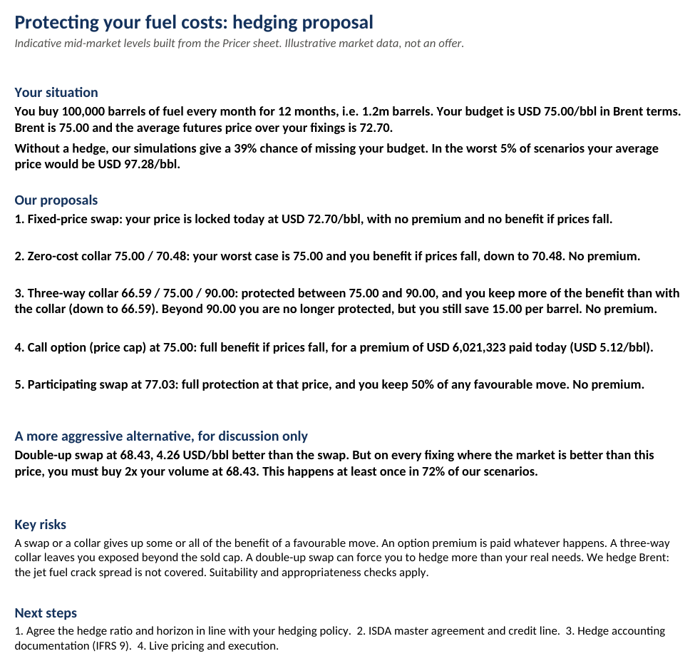

# Jet Fuel Hedging for an Airline: a Commodities Sales Case Study (Excel / VBA)

A European airline buys **100,000 barrels of fuel every month for the next 12 months**. Fuel is
its second biggest cost, so every rise in oil prices eats directly into its margin. The treasurer
has a **budget of USD 75/bbl (Brent equivalent)** and asks the bank's commodities sales desk
what to do.

This project puts me in the sales' seat: understand the client's risk, price the hedges the
desk would propose, compare them on the same basis and turn the numbers into a recommendation
the treasurer can act on. Everything is built in one Excel workbook, on the same model as my
FX Hedging Tool.

## The client's problem

| | |
|---|---|
| Client | European airline, buys 1.2m barrels over 12 months |
| Risk | Brent goes up: each barrel costs more |
| Budget | USD 75.00/bbl (the price at which the business plan still works) |
| Market | Brent front month 75.00, futures curve in backwardation, 12-month average 72.70 |

Doing nothing is not neutral. In our simulations, the unhedged airline misses its budget in
**39% of scenarios**, and in the worst 5% it pays an average of USD 97.28/bbl.

## The six solutions a sales would pitch

| Solution | Idea for the client | Cost |
|---|---|---|
| **Swap** | Fix the price today for every month | Free, but no benefit if prices fall |
| **Call (cap)** | Insurance: capped at 75, keep all the benefit of a fall | Premium paid upfront |
| **Zero-cost collar** | Capped at 75, benefit of a fall kept down to a sold put | Free |
| **Three-way collar** | Call spread 75/90 bought, put sold: keeps more of the fall than the collar | Free, but no protection above 90 |
| **Participating swap** | Protected at a slightly worse price, keep 50% of a fall | Free |
| **Double-up swap** | Much better price, but the airline buys 2x its volume when the market is lower | Free, but risky |

## Results

| Solution | Strike(s) | Premium (USD) | Expected price | Worst 5% | Best 5% | Misses budget |
|---|---|---:|---:|---:|---:|---:|
| No hedge | | 0 | 72.69 | 97.28 | 52.80 | 39% |
| Swap | 72.70 | 0 | 72.70 | 72.70 | 72.70 | 0% |
| Call (cap) | 75.00 | 6,021,323 | 72.69 | 80.12 | 57.86 | 50% |
| Zero-cost collar | 75.00 / 70.48 | 0 | 72.60 | 75.00 | 70.48 | 0% |
| Three-way collar | 66.59 / 75.00 / 90.00 | 0 | 72.45 | 84.17 | 66.61 | 22% |
| Participating swap | 77.03, 50% | 0 | 72.69 | 77.03 | 64.89 | 39% |
| Double-up swap | 68.43, 2x | 0 | 72.55 | 84.39 | 68.43 | 25% |

For an airline, a **lower price is better**. Prices in USD per barrel of Brent.

## What I would tell the treasurer

- **The swap is the only solution that guarantees the budget**, and at 72.70 it is even below
  it, because the futures curve is in backwardation.
- **The call keeps all the benefit of a fall, but the premium hurts.** USD 6m paid upfront
  (5.12/bbl) pushes the worst case to 80.12, above the budget.
- **The zero-cost collar is the safest fit.** No premium, the budget is the worst case, and the
  airline still benefits if Brent falls to 70.48.
- **The three-way collar is what airlines like most.** By selling the 90 call, the airline keeps
  the benefit of a fall down to 66.59 instead of 70.48. The price to pay: above 90 it is no
  longer protected (it only saves 15 USD/bbl), which happens in the worst scenarios.
- **The double-up swap looks attractive but is a product for experienced clients only.** Its
  price is 4.26 USD/bbl better than the swap, but on every month where Brent is below 68.43 the
  airline must buy twice its volume at 68.43. This happens at least once in 72% of scenarios.

My recommendation: hedge most of the volume with the **zero-cost collar** or the **three-way
collar**, depending on how much tail risk the airline accepts, and part with **swaps** to lock
in a certain price. The double-up swap is shown only for discussion.

The workbook writes this as a one-page client pitch that updates when the inputs change:

